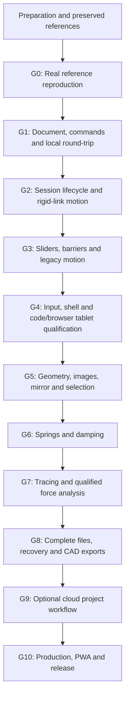

# Linkage Studio Rebuild Master Plan

Updated: 2026-11-16. Owner: Codex; product scope follows user direction.
Current stage: G0-G7 accepted; G8 code/browser/DXF checkpoint verified. User resumed
remaining updates after 0.16.0-rebuild.1; G9 code/browser checkpoint verified,
Microsoft target OPEN; G10 code/browser checkpoint verified, external qualifications
OPEN. Original feature backlog is implemented; supplied Azure-skill audit adds
explicit AZ-01/AZ-02 hardening follow-ups. See azure-integration-review.md,
evidence/g9/live-qualification.md, evidence/g10/acceptance.md,
evidence/g10/release-readiness.md, remaining-updates.md and
[G0 acceptance](evidence/g0/acceptance.md), [G1 acceptance](evidence/g1/acceptance.md)
[G2 acceptance](evidence/g2/acceptance.md), [G3 acceptance](evidence/g3/acceptance.md)
and [G4 acceptance](evidence/g4/acceptance.md), [G5 acceptance](evidence/g5/acceptance.md).
G6: [spring acceptance](evidence/g6/acceptance.md).
G7: [tracing and model-load acceptance](evidence/g7/acceptance.md).
G8: [versioned checkpoint and open target limits](evidence/g8/acceptance.md).

## Start Here Every Session

### Credits And Pages Publication

2026-11-16 user authorizes credits "Coauthored by Jake Whiting and Hugo Wilson",
removing the model tag, commit and publication to the existing GitHub Pages site.
Hugo's publication permission and the exact production Azure SPA callback are
confirmed by the user. Publish the isolated rebuild branch; preserve original
master/main/dirty experiments, no forced ref changes. Hosted verification and
live-site outcome are recorded in `evidence/pages/acceptance.md`. Existing physical
device, model-accuracy and Azure hardening qualifications remain explicit.

### UI-16 Follow-Up

The user requested reintegration of the earlier fork's upgraded hold-click UI and
checkbox/slider appearance. This is a scoped G4/C03/C04/C08/C10/C12/C13 follow-up,
not a replacement of the rebuilt solver/document/cloud layers. Historical reference:
fork commit `545051374fd176a74d3ce18f8fe6dfe99595dcf5` and the preserved root styles.
Candidate version: `0.16.0-rebuild.4`. Labeled radial body actions, explicit
release-only add/delete, native input styling and non-hold access are implemented.
Scoped code/browser contract accepted: 950 domain/27 tooling tests and 24 qualifying
regression suite/engine results on unchanged final source, with a G9 harness-only
retry explicitly recorded. Recovery's initial busy-list race was also repaired.
Earlier functional acceptance/evidence: `evidence/ui16/acceptance.md`.
User feedback correctly reopened motion/appearance parity: .3 faded rather than
fanned and switched both original files to a list. UI16-05 restores the historical
220ms/38ms fan, geometry and paint, retaining bounded/touch/command safeguards.
Native animated reference comparisons and both actual-file stationary holds pass;
final frozen cumulative 24/24,960 domain/27 tooling and fresh public install PASS.
Lead accepts the scoped UI16-05 contract; follow `evidence/ui16-motion/acceptance.md`.
Physical-device and unrelated Azure/target qualifications remain explicitly open.

### Example Playground

The user requested a demonstrator after UI16-05. Data/test/docs only: reproducible
`examples/mechanism-playground.slinker`, with three spring/slider/torsion systems,
outlines, four tracers and two model-load sensors. Existing .4 application source
remains unchanged. Native six-profile import/motion/drag/save-reopen and actual
sensor-chart ink PASS;962 domain tests/type/lint PASS. Standalone file delivered
and opened; scoped example accepted. Track `evidence/examples/acceptance.md`.

1. Read this file and [progress tracker](progress-tracker.md).
2. Read [visual and usability comparisons](visual-usability-comparison.md) for the
   surface being changed, plus [verification gates](validation-gates.md).
3. Inspect the current tree and latest evidence; preserve existing edits.
4. Choose the next unblocked tracker task. Update its status before starting.
5. Apply the [multi-agent execution rules](multi-agent-execution.md): keep the
   critical path with the lead; delegate only independent, bounded work. Make one
   integrated change and run its assertions and all accepted regression gates.
6. Add evidence, update comparison rows and record the next concrete action before
   ending the session. Update this master plan only when scope or sequencing changes.

Planning completion does not mean baseline capture, rebuilding or verification is
complete. Build/test success alone cannot close a functional or usability task.

## Document Map

| Document | Owns |
| --- | --- |
| This master plan | Objective, delivery strategy, architecture, scope and decisions |
| [Progress tracker](progress-tracker.md) | Task status, dependencies, stage acceptance and next action |
| [Multi-agent execution](multi-agent-execution.md) | Team roles, stage assignments, file ownership, integration and cost/time controls |
| [Visual/usability comparison](visual-usability-comparison.md) | Upstream/local/rebuild comparisons, screen states, task measures and visual decisions |
| [Source audit](README.md) | Historical comparison, feature provenance, architecture and known risks R01-R17 |
| [Verification gates](validation-gates.md) | Behavioral/numerical acceptance contracts and device requirements |
| [Evidence ledger](evidence-ledger.md) | Actual runs, artifact locations, limitations and gate results |
| [Azure skill review](azure-integration-review.md) | Required supplied-skill checklist, MSAL v5 adaptations and explicit hardening gaps |
| [Live OneDrive qualification](evidence/g9/live-qualification.md) | Actual disposable-file provider checks, failure reproduction, repair and remaining limits |
| [Session handoff template](templates/session-handoff.md) | Repeatable record for each implementation session |
| [Gate report template](templates/gate-report.md) | Evidence required to promote a stage |

## Objective And Boundaries

Rebuild a dependable mechanism editor from Huggabiz's last pre-fork release,
restoring useful fork features incrementally while preserving legacy mechanisms,
clear UI, data integrity and iPad usability.

- Upstream: `3dfe10512e105f863a582ce5cc4b3bb8a2006306`, v0.12.3.
- Current reference: `9954fca5bdfe48154353458b8c908d7d9f7af451`, v0.15.5,
  plus the archived uncommitted changes. Those repair attempts remain unverified.
- Mandatory real files: Winged Airer and WorkingScreenLow, with recorded hashes.
- User-confirmed Airer interaction: pull the upper brown arm toward the upper-left.
  Handle joint `g6kFted7Nm` and arm `link_cwDY2fFAEZ_g6kFted7Nm` are the primary
  acceptance targets. Sliding-foot motion is a separate diagnostic, not a substitute.
- Primary tablet: current-generation iPad on latest stable iPadOS, Safari and Home
  Screen installation. Record exact model/OS/Pencil on each qualification run.
- Core editor works as a guest. Cloud remains an optional storage capability.
- Preserve Hugo Wilson / Huggabiz credit and upstream provenance.
- Do not deploy, replace the existing workspace, erase original files or treat old
  patches as accepted fixes during preparation.

There is currently no custom server backend. Rebuild the document, physics and
storage layers with explicit contracts. Add a server only if a specific cloud or
collaboration requirement justifies one through a recorded architecture decision.

## Delivery Strategy

### Selective Parallel Execution

Use one lead agent and up to two workers within the current gate. Parallel work
does not change the gate order or permit skipping cumulative verification. Run
single-agent when the next step depends on unresolved shared contracts or when
delegation costs more coordination than useful work.

The lead owns the architecture, document/solver/input contracts, browser session,
integration, master documents and final acceptance. Worker A implements a bounded
feature in an assigned file set. Worker B prepares or runs independent regression
checks and comparisons against a pinned candidate. A worker's report is evidence
to review, not authority to mark a gate passed.

Use the stage assignment matrix in [multi-agent-execution.md](multi-agent-execution.md).
Freeze only the interface needed by the current task before splitting writes. Give
each worker a compact brief, relevant document sections, exact revision, acceptance
assertions and an exclusive file list. Close workers after integration; do not pay
for repeated full-repository investigations or idle agents.

G0 is the first measured pilot. Track elapsed time, worker runs, integration/rework
and usage where available. There is no assumed cost or speed saving. Review the
pilot before choosing concurrency for G1; use actual value delivered and overhead.

### Establish The Reference

Archive the exact current state before any source change. Create isolated checkouts
for pinned upstream, archived local reference and candidate rebuild. Give them
separate ports/origins and browser storage. Never run reference and candidate from
the same output directory or share PWA caches. Keep the current workspace intact.

Start G0 by running upstream and current app side by side. Use real import controls,
the same fixture and the same intended pointer path. Capture the full UI, the
moving mechanism, actual application state and console errors. The old screenshots
are supporting context; fresh comparable captures are still required.

### Establish A Small Working Slice

Build a minimal vertical slice: open local file, see bodies/joints, select/edit,
undo, simulate/drag, return to the saved design pose, save and reopen. Use the
upstream application as a reference while extracting clear boundaries. Do not
copy the current monolithic tool manager or port every feature in one change.

G1-G3 extend that slice in order. Add the browser test harness, file migrations,
session isolation and basic input checks alongside the first working feature.
The baseline test runner must also detect a deliberately broken drag/import path.

### Restore Features By Dependency

Input/selection and the editor shell form the foundation for shapes, springs,
analysis and persistence. Add each feature as a complete workflow: create, select,
edit, cancel, delete, undo, save/reopen, simulate and use on touch. Do not leave
persisted entities for a later pass while presenting them as finished tools.

For every feature, compare upstream where it exists, the old local implementation,
and the new implementation. Record what is retained, simplified or deliberately
different in the comparison ledger. Changes to interaction conventions require
explicit evidence and a rationale.

### Qualify And Release

Run a production build under the real deployment subpath with offline/update tests.
Pass the complete numerical, browser, data-integrity and automated tablet suite.
Under D15, unavailable physical hardware is a disclosed qualification limit, not
an automatic development or release stop. Never claim physical certification.
Release only after all required feature rows and cumulative gates have evidence.
Keep a known-good candidate commit and rollback artifact at each passed gate.

## Stage Dependencies

The first execution sessions have bounded deliverables:

1. **Reference session:** B02-B03. Isolated builds with observable build IDs,
   comparable desktop captures and working browser interaction. Resolve browser
   access first; document the exact blocker if it prevents the session.
2. **Reproduction session:** B04-B05. Import and drag both real mechanisms, record
   the intended moving handles, and implement assertions that detect the failure.
3. **Scope session:** B06/B08. Choose per-feature retain/simplify/defer dispositions,
   agree comparison differences, and accept G0 using the actual evidence bundle.
   B07 starts as hardware availability allows; physical qualification remains
   explicitly unverified when absent. D15 governs code/browser gate acceptance.

During these sessions the lead handles isolated runtime setup and real browser
reproduction. One worker can map fixture IDs/assertions while another prepares
the visual/usability comparison checklist from source. Actual comparisons wait
for lead-captured evidence; no worker may replace missing interaction proof with
a separate solver probe. Reassess worker need after each bounded deliverable.

These are work packages rather than calendar promises. A session can span turns;
its exit condition is evidence, not elapsed time or a completed code patch.

Input and serialization tests begin at G1 and repeat at every gate. G4 and G8
are full qualification points, not permission to postpone touch or persistence.
If a device is unavailable, code/browser qualification and implementation continue
under D15. Reports must distinguish those results from actual-device certification.

## Architecture Contracts

| Layer | Responsibility | Must Not Own |
| --- | --- | --- |
| Document/schema | Stable entity IDs, design pose, body membership, feature parameters, schema/model versions | Runtime velocities, hidden transient grab joints or React state |
| Codec/migrations | Shared local/cloud/recovery format; validated explicit migrations and loss diagnostics | Silent entity deletion, app-version guesses as permanent semantics |
| Commands/history | Atomic edits, transactions and undo/redo; revision/dirty tracking | One undo entry per simulation frame or network callback |
| Constraint compiler | Derived graph and compatibility policy from canonical document | React events, modifying saved rest lengths during mode changes |
| Simulation session | Positions, velocities, collision sides, errors, stepping and atomic commit | Shared mutable runtime across projects |
| Input controller | Pointer ownership, hit selection, tool gestures, cancel and device parity | Persistence or multiple competing gesture state machines |
| UI/renderer | Dense readable editor, object/property access, explicit states and same live app state | Independent document copies hidden from the mounted app |
| Storage adapters | Local file outcomes, recovery and optional OneDrive identity/conflicts | Mutating the active project after an obsolete asynchronous request |

Retain the existing web stack initially unless a specific measured limitation
justifies replacement. Pin dependencies and make install/build reproducible before
changing toolchain versions. Evaluate whether to repair or replace the physics
engine after baseline and analytical checks; upstream behavior alone is insufficient.

## Scope Coverage

All implemented feature families are candidates to retain; simplify interactions
where supported by comparison. Proposed backlog tools are separate from parity.

| Feature ID | Capability | Gate | Required Comparison |
| --- | --- | --- | --- |
| F01 | Bodies, pivots, fixed Base, membership and labels | G1 | C01, C03, C04 |
| F02 | Editing, delete, transactions and undo/redo | G1 | C03, C04, C12 |
| F03 | Local open/save, legacy migrations and dirty state | G1/G8 | C02, C11, C12 |
| F04 | Rigid links, DOF feedback, gravity and simulation lifecycle | G2 | C06, C07 |
| F05 | Sliders and limits | G3 | C03, C06, C07 |
| F06 | Collider barriers and assigned bodies | G3 | C03, C06, C07 |
| F07 | Mouse, fingers, Pencil, keyboard and accessibility | G1-G4 | C03, C05, C10, C12, C13 |
| F08 | Toolbars, body tree, properties, menus and panels | G4 | C01, C03, C04, C08, C10 |
| F09 | Pan/zoom/fit/grid/rulers and box/lasso selection | G4/G5 | C05, C08, C09 |
| F10 | Outlines, vertices, lock and optional outline COM | G5 | C06, C09 |
| F11 | Image import and transforms | G5 | C09, C11 |
| F12 | Rectangle/circle/N-gon and scoped trim | G5 | C03, C09, C10 |
| F13 | Mirror with stable identity and scope | G5 | C04, C09 |
| F14 | Linear springs, dampers, torsion and parameters | G6 | C03, C06, C08 |
| F15 | Path plotters and traces | G7 | C06, C07, C09 |
| F16 | Force loads, reactions and sensors | G7 | C06, C08, C11 |
| F17 | DXF, export units and SolidWorks macros | G8 | C11, C12 |
| F18 | Recovery and complete local persistence | G1/G8 | C02, C11, C12 |
| F19 | Projects library and Microsoft sign-in | G9 | C01, C02, C10, C12 |
| F20 | OneDrive saves/autosave/conflicts | G9 | C02, C11, C12 |
| F21 | PWA/offline/update, deployment and author credit | G10 | C01, C10, C11, C14 |

Two-point applied-force tools, annotations and collaboration are not existing
feature parity. Motor driver setup is a scope decision: engine code exists but a
complete exposed workflow was not established. Track decisions rather than silently
adding these to the rebuild.

## Working Rules And Definition Of Done

- Each change identifies feature IDs, risk IDs, gate, comparison rows and test cases.
- For delegated work, record task/agent, pinned revision, read/write scope and handoff
  in the tracker. Only the lead edits shared contracts and acceptance records.
- Update the tracker at task start and after verified completion, never all at once
  at the end. Use evidence links, not percentages based on code volume.
- Readiness requires implementation, relevant automation, full workflow testing,
  visual/usability comparison and required hardware evidence.
- Reproduce a defect before fixing it; preserve a failing regression test and the
  evidence showing why the fix is causal.
- On a failed gate, keep the stage open, record failure and work within that stage.
  Do not hide warnings, change expected results to fit the candidate or drop old tests.
- Before any source rewrite, archive current inputs and work in the candidate branch.
- Any new feature touching documents includes codec, migration, undo and deletion
  coverage in the same delivery slice.
- Future sessions read these documents first. The active task and next action live
  in the tracker; actual results live in the evidence ledger.

## Decisions And Assumptions

| ID | Decision | State |
| --- | --- | --- |
| D01 | Start from last Huggabiz release v0.12.3 | Confirmed by user |
| D02 | Current iPad/latest stable iPadOS; exact model/build recorded during testing | Confirmed target; device evidence pending |
| D03 | Safari and installed Home Screen app qualification | Planned coverage |
| D04 | Guest/local editor independent of Microsoft account | Implemented and browser-qualified through G9/G10; stalled auth/library cancellation cannot trap guest editing |
| D05 | Preserve implemented feature families; simplify UI using comparison evidence | Working scope; review individual exceptions |
| D06 | No custom backend until justified by a concrete requirement | Implemented document/physics/local/cloud layers in the static client; optional Microsoft service qualification remains separate |
| D07 | Compatibility means old files import/move in new app; backward export needs explicit loss policy | Legacy import/motion and source-preserving new saves qualified. No promise that an older app understands newly added features; full-feature backward export is not silently claimed |
| D08 | No claim of engineering-grade force accuracy until analytical qualification | G7 defines qualified unit-particle model loads and unavailable partial reactions under D19, not SI structural certification |
| D09 | Preserve author credits and verify redistribution terms before release | Required release task |
| D10 | No implementation gate complete without cumulative evidence | Delivery rule |
| D11 | Selective multi-agent execution: one lead plus at most two focused workers | Confirmed user direction; use only where independent work exists |
| D12 | Measure first pilot before claiming time/cost benefit or expanding concurrency | Delivery rule; actual billing may be unavailable |
| D13 | Airer primary acceptance uses the upper brown arm pulled toward upper-left | Confirmed by user 2026-11-15; G3 records the actual trajectory and independent 30-60 degree / spread >300 contracts; repeated original/reopened browser runs required |
| D14 | Codex executes verification and accepts gates without routine user QA/sign-off | User instruction 2026-11-15; real hardware limitations remain explicit, not claimed away |
| D15 | Progress continuously until complete or a genuine blocker; retain iPad functionality through code review and automated WebKit/touch/viewport checks | User instruction 2026-11-15; physical hardware remains unverified, not an automatic development stop or user unlock step |
| D16 | Trim removes explicitly crossed edges within selected shapes or active bodies, preserving other edges as persisted open paths | G5 data-safety correction to fork behavior that deleted vertices/whole triangles; analytical and cumulative browser qualification passed |
| D17 | Mirror retains constructive same-body membership, with explicit axis/scope and actual bitmap reflection | G5 comparison to fork; this is not a promise to create an independently moving cloned mechanism; original IDs/asset world poses retained |
| D18 | Springs retain the fork's linear motion scale, but labels do not claim SI calibration; torsion uses opposing moments and dissipative damping in the declared unit-particle model | G6 2026-11-15; fork-spring-audit documents same-sign torsion and unsupported SI labels; analytical and browser qualification mandatory |
| D19 | Force readings are qualified unit-particle model loads, not SI-certified structural loads; accumulate all projection impulses and distinguish incomplete contact reactions | G7 2026-11-16; evidence/g7/model-contract.md; 1% known-load/force-balance tests remain mandatory, not weakened to match inherited output |
| D20 | Use bounded SHAKE/RATTLE stepping only for undamped anchored positive-distance graphs without contact, springs or active grab; retain established PBD elsewhere | G7 2026-11-16; measured brute-force refinement rejected for frame-time/timestep regression; unchanged 2% pendulum bounds and both real undamped fixture timesteps now pass; this does not certify conservative energy for coupled/contact graphs |
| D21 | Separate verified implementation from unavailable external target qualification: unresolved functional failures still block progression; explicitly tracked CAD/SolidWorks or real-account qualification may remain OPEN while independent implementation continues | 2026-11-16; follows autonomous progression D14/D15. Never label an unrun target check PASS or mark overall delivery complete. G8 code/browser acceptance still requires the entire cumulative suite; target-app rows remain unverified until actually executed. Software-launch permission is separate from routine QA/sign-off. |
| D22 | Stop at the files/recovery/export checkpoint and create a versioned GitHub commit; do not start G9 | User direction 2026-11-16 supersedes continuous progression for this session. Use 0.16.0-rebuild.1 on a separate codex branch, retain qualification limits and the untouched original workspace; no master replacement or deployment. |
| D23 | Resume G9/G10 and final scrub after the published checkpoint, with Codex-owned progression | User direction 2026-11-16 supersedes D22's stop. remaining-updates.md maps deliverables; codex/rebuild-cloud-pwa continues from 1b6f723 without changing its tag or original master. External qualifications remain explicit under D15/D21. |

When changing a decision, add date, evidence and affected tasks/comparison rows.
Do not replace this record with assumptions buried in code or chat.
